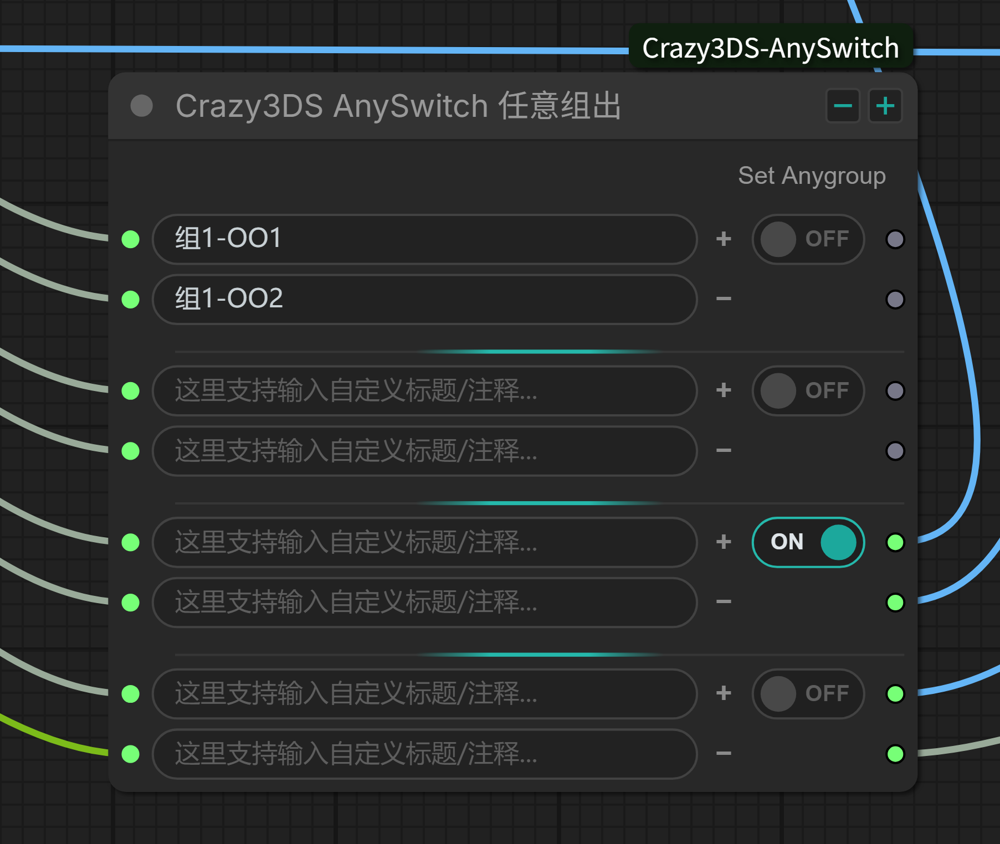
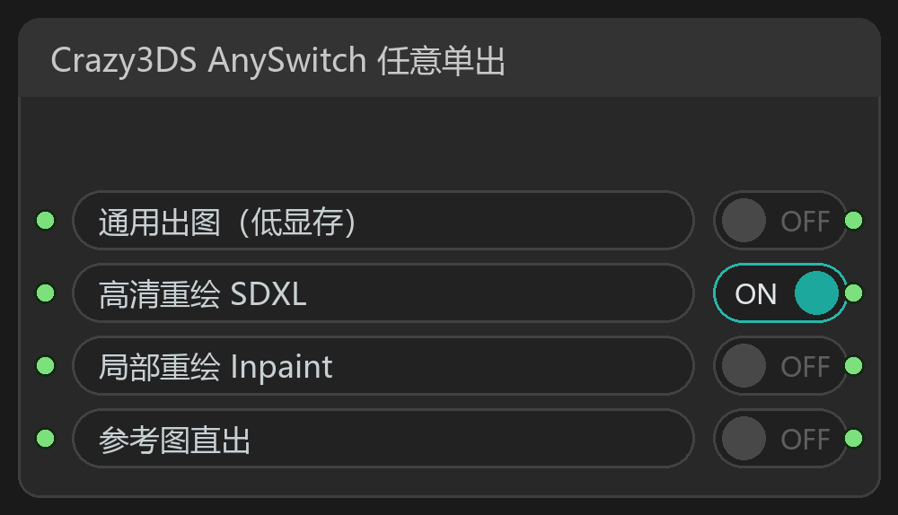
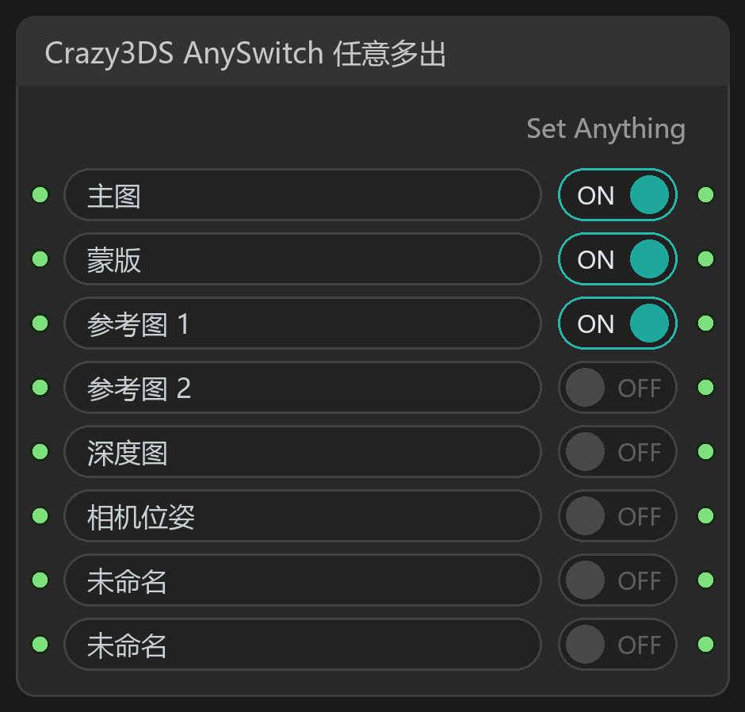
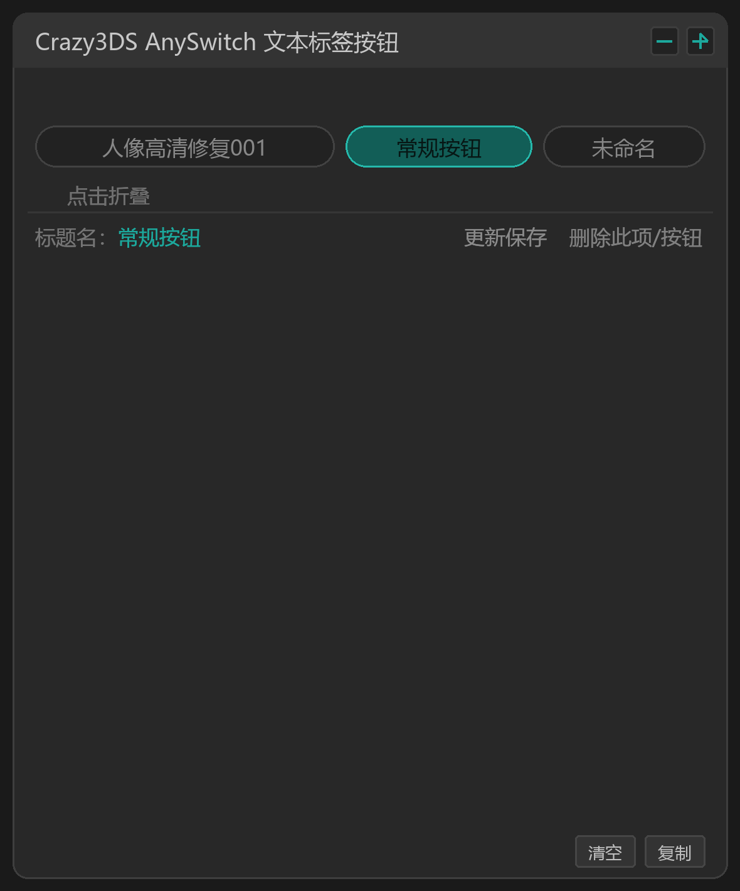
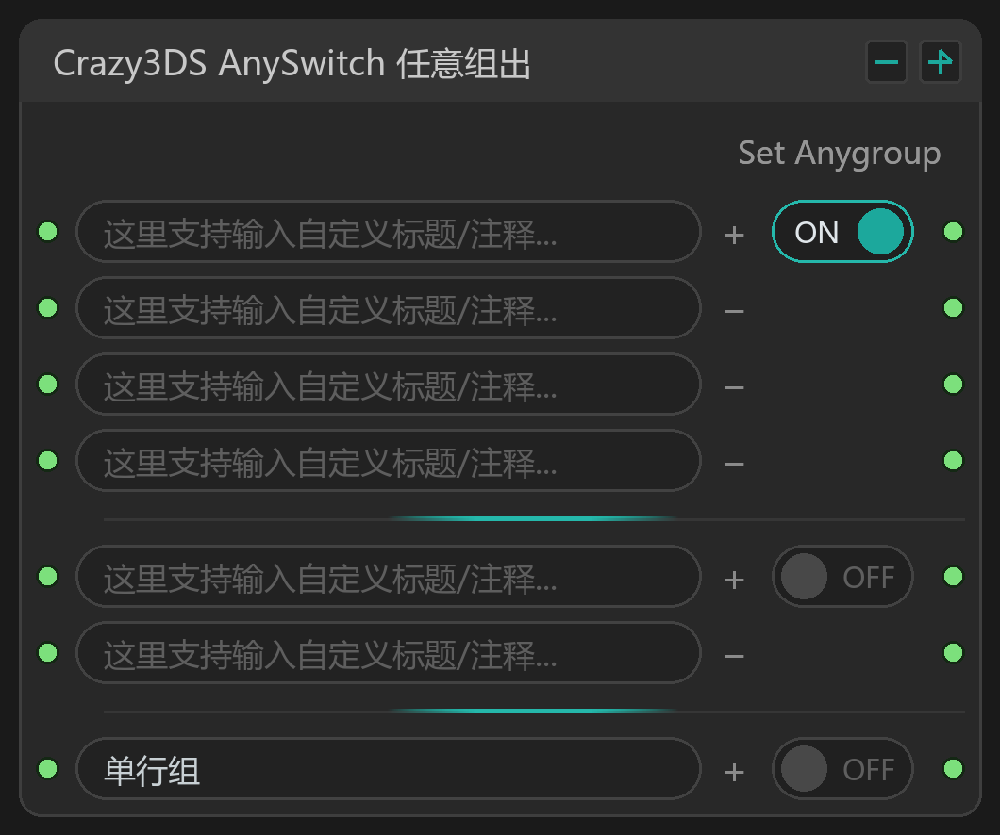
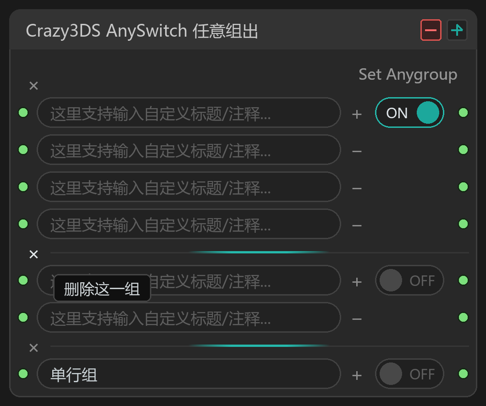

# Crazy3DS-AnySwitch

> 给 ComfyUI 装一套"总开关"：一个工作流里塞进好几套参数、好几条分支，点一下鼠标就切换。
> 而且**没被点开的那一路根本不会执行**——不占显存、不浪费时间。

适配 ComfyUI（Windows / Linux / macOS），零第三方依赖，装上就能用。



---

## 一、先说人话：这东西到底解决什么麻烦

玩 ComfyUI 的人多半遇到过这几种烦：

- 同一套流程，想换风格（写实 / 二次元 / 插画），就得把提示词、模型、参数全改一遍，改完想退回去还得再改一遍。
- 文生图、图生图、局部重绘其实骨架一样，只是入口不同，却被迫存成三个工作流，改一个 bug 要改三遍。
- 想试试"加不加 ControlNet""开不开高清修复"，只能删线、连线、再删线，连错一次就得重来。
- 显存紧张时想临时关掉某一支，只能把线拔了；想恢复又不记得原来接哪儿。
- 常用的提示词、分辨率、步数，每次都要从记事本里复制粘贴。

**这个插件就是给这些事装开关。**

四条输入、四条输出摆在一起，每条前面挂一个开关，点哪个亮哪个，只有亮着的那条会真正跑起来；关掉的那条不是"跑完再丢掉"，而是**压根不执行**。

于是你可以：

- 一个工作流里放四套风格，点一下换一套；
- 低显存/高显存两套参数，点一下切换；
- 输入端挂三张不同参考图，想用哪张点哪张；
- 把常用的提示词做成一排按钮，点一下直接送进文本节点。

不用复制工作流，不用拔线，不用记参数。

---

## 二、一分钟装上

### 方式 A：git clone（推荐，方便更新）

```bash
cd ComfyUI/custom_nodes
git clone https://github.com/<your-name>/Crazy3DS-AnySwitch.git
```

### 方式 B：下载压缩包

1. 在 GitHub 页面点 `Code → Download ZIP`
2. 解压，把里面的 `Crazy3DS-AnySwitch` 整个文件夹放进 `ComfyUI/custom_nodes/`
3. 确认目录结构是 `ComfyUI/custom_nodes/Crazy3DS-AnySwitch/__init__.py`

### 最后一步

**重启 ComfyUI**，浏览器按 `Ctrl + F5` 硬刷新。

右键画布 → `Add Node` → 搜 `AnySwitch`，或直接看分类 **Crazy3DS / Switch**，四个节点都在里面。

> 不需要 `pip install` 任何东西；不需要装前端构建工具。

---

## 三、怎么用：三步上手

以"一个工作流切换三种风格"为例：

1. 拖一个 **Crazy3DS AnySwitch 任意单出** 到画布，接在采样器的 `positive` 前面。
2. 把三套「CLIP 文本编码」的输出分别接到它的 `input_1`、`input_2`、`input_3`。
3. 点一下第二行前面的 `OFF`，它变 `ON` —— 从此出图就走第二套提示词了。

就这样。开关行上的文字可以直接点着改，写上"写实 / 二次元 / 插画"，下次打开工作流一眼就懂。



---

## 四、适合用在哪些场景

下面这些都是实际能干的事，不是凑数：

| # | 场景 | 用哪个节点 |
|---|---|---|
| 1 | 一套流程切多种画风（写实 / 二次元 / 国风），提示词+模型一起换 | 任意单出 |
| 2 | 同一台机器上准备"低显存"和"高质量"两套采样参数 | 任意单出 |
| 3 | SDXL 与 SD1.5 两条链路共用一个工作流，按需切换 | 任意单出 |
| 4 | 文生图 / 图生图 / 局部重绘 三合一，只切入口 | 任意单出 |
| 5 | 挂多张参考图，这次用哪张点哪张（可同时开多张） | 任意多出 |
| 6 | ControlNet 组合开关：Canny、Depth、OpenPose 想开几个开几个 | 任意多出 |
| 7 | 主图 + 蒙版 + 参考图 + 深度图 一路直通下游，各自独立开关 | 任意多出 |
| 8 | 把常用提示词做成按钮，点一下自动填进 CLIP 文本 | 文本标签按钮 |
| 9 | 分辨率、步数、CFG 做成按钮，甚至能写 `512 * 1.5` 自动算成 768 | 文本标签按钮 |
| 10 | 一条完整链路里准备两套"出图 + 后处理"组合，整组切换 | 任意组出 |
| 11 | 给客户/朋友的工作流做成"按钮面板"，中文标注清楚 | 全部 |
| 12 | A/B 测试：同一个种子，两套参数快速对比 | 任意单出 / 组出 |

---

## 五、独到之处（和别的开关节点比）

### 1. 真·懒执行：关掉的那一路根本不会跑

这不是"跑完再把结果丢掉"。节点把每一路都声明成 **lazy 输入**，执行前先问：哪一路是开的？只向上游索要这一路。

结果：关掉的分支里那些大模型、大采样器、高清修复，**一次都不会执行** —— 省时间，也省显存。你放十条分支进去也不会变慢，只有开着的那条在跑。

### 2. 关掉一路不会"连坐"整条下游

这是最容易踩坑的地方。假设你把开关的两路都接进同一个「多图编辑」节点，其中一路关着：

- 普通开关节点的做法是"关掉就抛出中断" → **整个下游节点直接不执行**，你明明开着一路也白搭。
- 本插件会先看一眼拓扑：如果下游还连着别的有效输入，就把这一路传成 `None`，**下游照常执行**；
  只有当这一路是下游唯一的入口（比如直接接 `PreviewImage`）时，才安静地停下。

### 3. 全部关掉 = 安静停机，不报错

四路全 `OFF` 时，下游被静默阻断，控制台不会刷一片红色报错。想"今天什么都不跑"就这么点。

### 4. 加一行、删一行，连线自动跟着走

点 `+` 加一路、点 `−` 删一路，**原来接好的上下游线会自动重连到正确的行**，不会像多数动态端口节点那样一增删就掉线、要你手动补。

### 5. 任意类型都能过

端口类型是通配的（`*`）：图像、潜空间、模型、CLIP、条件、ControlNet、数字、字符串…… 都能穿过去。不需要为不同数据类型装不同插件。

### 6. 「任意组出」：一个开关管一整组

有些东西天然是成套的：一个提示词 + 一个负面词 + 一个模型 + 一个采样器。只切其中一个会出错。
组出节点把这几行绑成一组，**一个开关同时通断整组**，而且同一时刻只允许一组开着，天然互斥。

### 7. 「文本标签按钮」不只是按钮

它输出的内容会自动"看懂"：

- 纯整数 → 输出数字 `1024`
- 纯小数 → 输出 `0.75`
- 算式/函数 → 直接算出来（`512 * 1.5` → `768`，`sqrt(1024)`、`round(2.6)` 都行）
- 其他 → 原样当文本输出

所以同一个节点既能喂提示词，也能喂分辨率、步数、CFG。

### 8. 标签数据按工作流隔离，不串味

文本标签节点的内容**跟着工作流走**：

- 保存时会写到 `data/workflows/<该工作流的唯一ID>.json`
- 换个工作流就是另一份文件，**A 里存的东西不会跑到 B 里**
- 改动即时自动保存，标题栏右侧的「更新保存」可强制立即落盘

### 9. 界面是画出来的，不是拼 HTML

整块面板用 ComfyUI 自己的 Canvas 绘制：和原生节点同色系、可自由缩放、每个按钮都有悬停提示、标题就地编辑。缩放、拖动、连线和普通节点完全一致。

---

## 六、四个节点逐个说

### 1) Crazy3DS AnySwitch 任意单出

> 多选一。像收音机的选台按钮。


**端口**：`input_1 … input_n`（可自动增加到 32 路）→ 一个 `Set Anything` 输出

**交互**：
- 点某行的 `OFF` → 该行变 `ON`，其它行自动变 `OFF`（单选）
- 再点一次 `ON` → 全部关闭（此时下游静默停止）
- 点行内文字 → 就地改标题/注释
- 连到最后一行的输入时，会自动补出下一行

**典型用法**：挂 3～4 套 CLIP 条件，一个开关换风格。

---

### 2) Crazy3DS AnySwitch 任意多出

> 每个通道独立。像一排电源插座，各自带开关。



**端口**：`input_n` → `out_n`，一行进一行出，互不影响

**交互**：
- 每行开关独立，想开几个开几个
- 关掉的行：如果下游还有别的有效输入，就传 `None` 让下游继续跑；否则安静停下
- 支持 32 路；`Set Anything` 标签在右上角

**典型用法**：多张参考图/多个 ControlNet 自由组合。

---

### 3) Crazy3DS AnySwitch 文本标签按钮

> 一排按钮，点谁就把谁的内容送出去。



**端口**：一个 `Set Anything` 输出

**交互**：
- 点胶囊切换当前按钮
- 标题栏 `[−]`：进入删除模式（每个按钮右上角出现 ×）
- 标题栏 `[+]`：新增按钮
- 「点击展开」区域：改标题、写正文、`更新保存` / `删除此项`、`清空` / `复制`
- 正文框支持多行、滚动、滚轮穿透画布缩放

**内容自动识别**：`1024` → 整数；`0.75` → 浮点；`512 * 1.5` → 768；其余 → 文本

**保存**：改动自动保存到当前工作流的专属 JSON；跨工作流互不影响。

---

### 4) Crazy3DS AnySwitch 任意组出

> 一个开关管一整组，同一时刻只允许一组开启。



**端口**：每组若干行，每行 `input_n → out_n` 独立贯通

**交互**：
- 每组**首行**右侧有一个 `ON / OFF` 开关：点开这一组，其它组自动关闭
- 行尾 `+`：给本组加一行；行尾 `−`：删掉这一行
- 标题栏 `[+]`：新增一组；`[−]`：进入删除组模式
- 删除模式或只剩一行的组，左侧出现 `×`，点它删掉整组
- 每个可点区域都有悬停提示



**典型用法**：把「提示词 + 负面词 + 模型 + 采样器」绑成一组，四套风格就是四组，切换只需一次点击。

---

## 七、交互速查表

| 你想做的事 | 操作 |
|---|---|
| 切换单出通道 | 点该行的 `ON / OFF` |
| 同时开多路 | 用「任意多出」 |
| 增加一路 | 点行尾 `+`（或直接连到最后一个输入） |
| 删除一路 | 点该行行尾 `−` |
| 改标题/注释 | 点行内文字，回车确认、Esc 取消 |
| 新增一组 | 标题栏右上 `+` |
| 删除整组 | 标题栏右上 `−` 进入删除模式，点组前 `×` |
| 看某个按钮干嘛的 | 鼠标悬停，会弹出说明 |
| 调大小 | 拖右下角；最小宽度 180，高度会自动贴合内容 |

---

## 八、数据存在哪

| 文件 | 用途 |
|---|---|
| 工作流内的 `tag_state` 快照 | 每次打开工作流都用它，最权威 |
| `data/workflows/<工作流ID>.json` | 该工作流标签内容的磁盘副本，便于备份/迁移；新拖入的标签节点会从这里继承 |
| `data/anyswitch_presets.json` | 旧版全局配置，保留接口但**不再自动读写**，可忽略 |

工作流 ID 保存在工作流 JSON 的 `extra.crazy3ds_workflow_id` 里，随文件一起走，所以：

- 复制给别人 → 对方打开看到同样的按钮内容
- 另存为新工作流 → 会继承原来的 ID（等于继承标签内容），想独立就在新工作流里改一下再保存

---

## 九、常见问题

**Q：全部关掉之后，下游报错/不执行了？**
A：这是设计行为——全关等于"什么都不跑"，下游被静默阻断，不刷报错。想跑就打开一路。

**Q：关掉的分支还占显存吗？**
A：不会。被关掉的那一路是 lazy 的，它的上游根本不会执行。**除非**那段上游同时被别的开着的东西共用。

**Q：最多能挂多少路？**
A：每个节点 32 路（行）。不够就并排放两个节点。

**Q：换了工作流，标签内容怎么变了？**
A：标签内容按工作流隔离。每个工作流有自己的 `data/workflows/xxx.json`；这是刻意设计，避免互相覆盖。

**Q：`512 * 1.5` 这种写法真的会算？**
A：会，输出 768（整数结果自动取整）。支持 `+ - * / // % **`、`abs round min max int float sqrt sin cos tan log` 等。

**Q：节点太宽/太窄怎么办？**
A：拖边角即可，最小 180 宽；行高固定 22px，高度跟着行数走。

**Q：改完 JS 没生效？**
A：浏览器 `Ctrl + F5` 硬刷新；改了 `.py` 需要重启 ComfyUI。

---

## 十、执行语义（给想深究的人）

- 所有输入声明为 `lazy`，`check_lazy_status` 只索取"当前开启"的行，其余上游零消耗。
- `IS_CHANGED` 用状态 JSON 的 sha256，切换开关必然触发重新执行。
- 关闭的行返回 `ExecutionBlocker`；但会先做拓扑判断：若下游是汇聚型多输入节点且仍有其它有效输入，则改传 `None`，避免整条链被连坐阻断。
- 输出类型 `*`（AlwaysEqualProxy），兼容任意上游。

---

## 十一、目录结构

```
Crazy3DS-AnySwitch/
├── __init__.py                 # 合并两个后端模块的节点注册
├── nodes.py                    # 单出 / 多出 / 文本标签按钮
├── nodes_group.py              # 任意组出（独立模块，便于单独维护）
├── js/
│   ├── crazy3ds_anyswitch.js   # 前三个节点的前端
│   └── crazy3ds_anyswitch_group.js  # 组出节点的前端（自包含）
├── data/
│   ├── anyswitch_presets.json  # 旧版全局配置（保留，不再自动读写）
│   └── workflows/              # 运行时按工作流生成
└── docs/images/                # 说明用截图
```

---

## 十二、更新日志

### v1.0.0
- 四个节点首发：任意单出 / 任意多出 / 文本标签按钮 / 任意组出
- 懒执行 + 拓扑感知阻断
- 动态端口与连线自动迁移
- 文本标签节点支持表达式求值
- 标签数据按工作流隔离存储

---

## 十三、许可

MIT License，见 [LICENSE](LICENSE)。可自由用于个人与商业项目，二次修改请保留版权声明。

---

## English TL;DR

**Crazy3DS-AnySwitch** adds four switch nodes to ComfyUI:

- **AnySwitch Single** — pick exactly one of N inputs (radio buttons).
- **AnySwitch Multi** — N independent pass-through channels, each with its own toggle.
- **Tag Buttons** — a panel of buttons that outputs text, numbers, or evaluated expressions (`512 * 1.5` → `768`).
- **AnySwitch Group** — one toggle per group, all rows in the active group pass through, groups are mutually exclusive.

Key points:

- **Truly lazy**: disabled branches are never executed, so they cost no VRAM and no time.
- **No collateral blocking**: a closed channel feeding a merge node is passed as `None` instead of aborting the whole downstream chain.
- Ports grow/shrink automatically and existing links are re-mapped, so adding or removing a row never breaks your graph.
- Works with any type (`*`), zero dependencies, UI drawn on canvas like native nodes.
- Tag data is stored per workflow (`data/workflows/<workflow-id>.json`), so different workflows never overwrite each other.

Install: drop the folder into `ComfyUI/custom_nodes/`, restart ComfyUI, hard-refresh the browser. Nodes appear under **Crazy3DS / Switch**.
